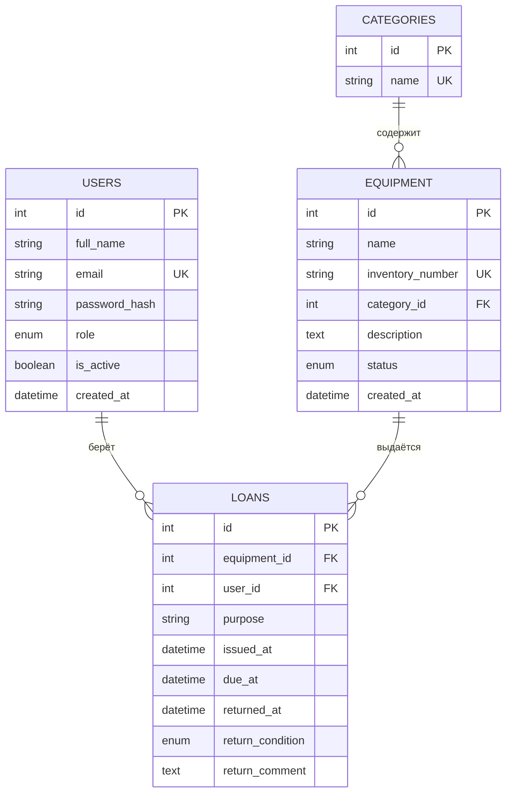
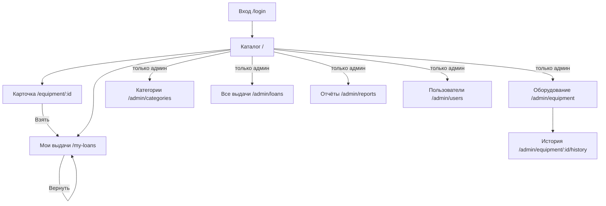

# Архитектура: информационная система учёта оборудования для выездных работ

**Стек:** React (Vite) + Node.js + Express + PostgreSQL + Prisma
**Назначение:** дипломный проект, демонстрация на защите (небольшой масштаб: десятки пользователей, сотни единиц оборудования).

**Описание.** Веб-сайт, где сотрудники, выезжающие к клиентам, берут оборудование со склада на самовывоз, указывают срок возврата и возвращают его, отмечая состояние. Система хранит полную историю движения каждой единицы, показывает занятое оборудование как «Недоступно», строит отчёты и выгружает данные в Excel и PDF.

> **Мои решения:**
> 1. Ролей три: гость (не вошёл), сотрудник, администратор.
> 2. Сотрудник сам «берёт» и «возвращает» оборудование на сайте (самовывоз, без кладовщика-посредника).
> 3. Самостоятельной регистрации нет: это внутренняя система компании, поэтому аккаунты создаёт администратор и сам задаёт начальный пароль. Первого администратора создаёт скрипт начальных данных (`seed.js`).
> 4. Максимальный срок выдачи — 30 дней (число можно поменять).

---

## 1. Пользователи и роли

| Роль | Кто это | Что может |
|---|---|---|
| **Гость** | Не вошёл в систему | Только войти (регистрации нет, аккаунт выдаёт администратор) |
| **Сотрудник** | Любой, кто выезжает к клиентам | Смотреть каталог, искать и фильтровать, открывать карточку, брать свободное оборудование, возвращать то, что взял сам, видеть свои выдачи |
| **Администратор** | Отвечает за склад | Всё, что сотрудник, плюс: создавать аккаунты сотрудников, добавлять и редактировать оборудование и категории, менять статусы (ремонт, списание), видеть всю историю и отчёты, выгружать Excel/PDF, блокировать пользователей и менять роли |

**Почему так:** роли нужны, чтобы сотрудник не мог, например, списать чужое оборудование или посмотреть историю всех коллег. Если сделать одну общую роль, любой сможет редактировать склад и данные начнут «портиться».

**Почему три, а не больше:** для демонстрации этого достаточно; роль кладовщика отдельно можно добавить позже (см. раздел 10).

---

## 2. MVP (минимальная первая версия)

**Что входит в MVP (8 функций):**

1. Вход в систему. Аккаунты сотрудников создаёт администратор (самостоятельной регистрации нет).
2. Каталог оборудования со статусами («Доступно» / «Недоступно» / «В ремонте» / «Списано»).
3. Поиск по названию и инвентарному номеру, фильтр по категории и статусу.
4. Карточка оборудования (описание, категория, статус, дата возврата, если занято).
5. Взять оборудование: выбрать срок возврата и (по желанию) указать цель выезда.
6. Вернуть оборудование: указать состояние и комментарий.
7. «Мои выдачи»: что у меня сейчас и что я брал раньше.
8. Админ-часть: создание аккаунтов сотрудников, добавление и редактирование оборудования и категорий, смена статуса, история движения по каждой единице.

**Что НЕ входит в MVP и почему:**

| Функция | Почему отложена |
|---|---|
| Загрузка фото | Вынесена в раздел 10 «Расширение»: нужна работа с файлами, а без фото система полностью работает |
| Уведомления | Вынесены в раздел 10 «Расширение»: нужна фоновая задача по расписанию; ядро системы от них не зависит |
| Отчёты | Строятся из уже накопленных данных о выдачах, поэтому делаем после ядра |
| Экспорт в Excel/PDF | Это «оболочка» над отчётами, поэтому идёт после них |
| Блокировка пользователей и смена ролей | В MVP достаточно создавать аккаунты; блокировка и смена роли нужны реже, их добавим позже |

> **Этап 2** (после MVP): отчёты, экспорт в Excel/PDF, блокировка пользователей и смена ролей. Он начинается **только после того, как в MVP работает сценарий «вошёл → взял → вернул»**. Фото и уведомления в проект не входят: они описаны в разделе 10 «Расширение», чтобы объём был реалистичным.
>
> **Порядок работы:**
> 1. MVP: вход → каталог → взять → вернуть → админ-часть.
> 2. Этап 2 по очереди: отчёты → экспорт Excel/PDF → блокировка и роли.
> 3. Защищаем MVP и то, что успели из этапа 2.

**Почему так:** если начать со всего сразу, к дедлайну не будет работать ничего. Если сначала сделать сквозной сценарий «вошёл → нашёл → взял → вернул», уже есть что показывать на любом этапе.

---

## 3. Пользовательские истории

| № | История | MVP? |
|---|---|---|
| 1 | Как **гость** (сотрудник, которому выдали аккаунт), я хочу войти в систему, чтобы пользоваться ей | ✅ MVP |
| 2 | Как **сотрудник**, я хочу видеть каталог со статусами, чтобы понимать, что сейчас свободно | ✅ MVP |
| 3 | Как **сотрудник**, я хочу искать оборудование и фильтровать по категории и статусу, чтобы быстро найти нужное | ✅ MVP |
| 4 | Как **сотрудник**, я хочу открыть карточку оборудования (описание, дата возврата, если занято), чтобы решить, подходит ли оно | ✅ MVP |
| 5 | Как **сотрудник**, я хочу взять свободное оборудование на выбранный срок, чтобы выехать к клиенту | ✅ MVP |
| 6 | Как **сотрудник**, я хочу вернуть оборудование, указав его состояние, чтобы следующий человек знал, в каком оно виде | ✅ MVP |
| 7 | Как **сотрудник**, я хочу видеть «Мои выдачи», чтобы не забыть, что и до какого числа я должен вернуть | ✅ MVP |
| 8 | Как **администратор**, я хочу добавлять и редактировать оборудование и категории, чтобы каталог был актуальным | ✅ MVP |
| 9 | Как **администратор**, я хочу менять статус (в ремонт, списать, вернуть в работу), чтобы сломанное не выдавалось | ✅ MVP |
| 10 | Как **администратор**, я хочу видеть историю движения каждой единицы, чтобы понимать, кто и когда её брал и в каком состоянии вернул | ✅ MVP |
| 11 | Как **администратор**, я хочу отчёты («у кого что на руках», «просрочки»), чтобы контролировать склад | ⏳ Этап 2 |
| 12 | Как **администратор**, я хочу выгружать отчёты в Excel и PDF, чтобы отдавать их руководству | ⏳ Этап 2 |
| 13 | Как **администратор**, я хочу создавать аккаунты сотрудников (а позже блокировать их и менять роль), чтобы доступ был только у своих | ✅ MVP (создание), ⏳ Этап 2 (блокировка, роль) |

---

## 4. Бизнес-правила

Это правила, которые **сервер проверяет всегда**.

> **Общая причина, почему нельзя проверять только в браузере:** браузер находится на компьютере пользователя, и любой человек может отправить запрос напрямую (через консоль, Postman), минуя твою страницу и её кнопки. Всё, что проверено только в React, обходится за минуту.

| № | Правило | Почему нельзя только в браузере |
|---|---|---|
| Б1 | Нельзя взять оборудование, которое уже выдано | Два человека могут нажать «Взять» одновременно на устаревшей странице; решает только сервер в момент записи |
| Б2 | Взять можно только оборудование со статусом «Доступно» (не в ремонте, не списанное) | Кнопку «Взять» можно «включить» в браузере или отправить запрос вручную |
| Б3 | Срок возврата обязателен, должен быть в будущем и не дальше 30 дней | Дату можно подменить в запросе |
| Б4 | Вернуть оборудование может только тот, кто его взял, или администратор; дважды вернуть нельзя | Иначе любой подставит чужой номер выдачи и «вернёт» чужое |
| Б5 | При возврате состояние обязательно. Если оно не «Хорошее», статус автоматически становится «В ремонте» (уведомление админам вынесено в раздел 10 «Расширение») | Иначе сломанное оборудование попадёт обратно в выдачу |
| Б6 | Сотрудник видит только свои выдачи; полная история и отчёты доступны только администратору | Скрыть кнопку не значит закрыть данные: адрес API можно открыть напрямую |
| Б7 | Менять каталог, категории, статусы и пользователей может только администратор | То же: роль проверяется на сервере по токену, а не по интерфейсу |
| Б8 | Оборудование с историей нельзя удалить, только списать | Иначе история выдач потеряет смысл (ссылки в никуда), а доказать, кто что брал, будет нельзя |
| Б9 | Самостоятельной регистрации нет: аккаунты и роли создаёт только администратор | Это внутренняя система компании. Иначе любой человек из интернета создаст себе аккаунт и сможет «брать» оборудование, а в запросе регистрации можно было бы дописать `role: ADMIN` |
| Б10 | Email уникален без учёта регистра (`Ivan@…` и `ivan@…` это один человек): перед сохранением и при входе он приводится к нижнему регистру; пароль не короче 8 символов | Проверка в браузере не мешает отправить запрос в обход формы |
| Б11 | Заблокированный пользователь не может войти и брать оборудование | Токен, выданный до блокировки, ещё работает, и сервер должен проверять статус при каждом запросе |

---

## 5. База данных

### 5.1. Таблицы и поля

**users** (пользователи)

| Поле | Тип | Пояснение |
|---|---|---|
| id | INT, PK, автоинкремент | Уникальный номер |
| full_name | VARCHAR(100) | ФИО |
| email | VARCHAR(150), UNIQUE | Логин (хранится в нижнем регистре) |
| password_hash | VARCHAR(255) | Хэш пароля (зашифрованный необратимо; сам пароль не хранится) |
| role | ENUM: EMPLOYEE, ADMIN | Роль |
| is_active | BOOLEAN, по умолчанию true | false, если заблокирован |
| created_at | TIMESTAMP | Дата создания аккаунта |

**categories** (категории оборудования)

| Поле | Тип | Пояснение |
|---|---|---|
| id | INT, PK | |
| name | VARCHAR(100), UNIQUE | Например: «Электроинструмент», «Измерительные приборы» |

**equipment** (единицы оборудования)

| Поле | Тип | Пояснение |
|---|---|---|
| id | INT, PK | |
| name | VARCHAR(150) | Название |
| inventory_number | VARCHAR(50), UNIQUE | Инвентарный номер (например, «ЭИ-0123») |
| category_id | INT, FK → categories.id | Категория |
| description | TEXT, может быть пустым | Описание |
| status | ENUM: AVAILABLE, ISSUED, REPAIR, WRITTEN_OFF | Текущий статус |
| created_at | TIMESTAMP | |

**loans** (выдачи, она же история движения)

| Поле | Тип | Пояснение |
|---|---|---|
| id | INT, PK | |
| equipment_id | INT, FK → equipment.id | Что взяли |
| user_id | INT, FK → users.id | Кто взял |
| purpose | VARCHAR(255), может быть пустым | Цель выезда (адрес, объект) |
| issued_at | TIMESTAMP | Когда взял |
| due_at | TIMESTAMP | До какого срока должен вернуть |
| returned_at | TIMESTAMP, **пусто, пока не вернули** | Когда вернул |
| return_condition | ENUM: GOOD, MINOR_DAMAGE, BROKEN, пусто до возврата | Состояние при возврате |
| return_comment | TEXT, может быть пустым | Комментарий |

> Если `returned_at` пусто, значит выдача **активна** (оборудование на руках).

> Даты храним в UTC (единое мировое время), а на странице переводим в местное. Так не будет путаницы с часовыми поясами.

### 5.2. Связи

| Связь | Тип | Как читать |
|---|---|---|
| categories → equipment | один-ко-многим | В одной категории много единиц, у единицы одна категория |
| users → loans | один-ко-многим | Один человек берёт много раз |
| equipment → loans | один-ко-многим | Одну единицу берут много раз (по очереди) |
| **users ↔ equipment** (через loans) | **многие-ко-многим** | Много людей брали много разных единиц; таблица `loans` и есть «мост» между ними, поэтому в ней ещё лежат даты и состояние |

### 5.3. ER-диаграмма



### 5.4. Проверка: дублирование и расширяемость

**Дублирование данных.**
- Единственное осознанное дублирование: `equipment.status = ISSUED` повторяет факт «есть выдача без `returned_at`». Мы оставляем его как осознанный повтор для быстрого фильтра в каталоге: статус показывается без поиска по всей истории выдач.
- **Как не дать им разойтись:** взятие и возврат всегда выполняются внутри одной *транзакции* (всё или ничего: либо записались и выдача, и новый статус, либо не записалось ничего).
- Имя человека и название оборудования в `loans` **не копируются**: хранятся только ссылки (`user_id`, `equipment_id`). Если исправить имя в `users`, оно изменится везде.
- Категория хранится ссылкой, а не текстом, поэтому опечатка вроде «Электроинструмент» / «Электро-инструмент» невозможна.

**Можно ли добавить новое, не ломая старое?** Да, новые функции добавляются **новыми таблицами или полями**, а существующие остаются как есть. Примеры: ремонты, бронирование, фото, уведомления, QR-коды. Подробнее в разделе 10.

**Почему так (две таблицы для «оборудования» и «выдач», а не одна):** если хранить «кто взял» прямо в `equipment`, при новой выдаче старая запись затрётся, и истории не будет. А история это обязательное требование.

**Почему инвентарный номер отдельно от `id`:** `id` служебный номер базы, а инвентарный номер это то, что написано на наклейке на оборудовании и что знают люди; он должен быть уникальным, но может иметь буквы и формат компании.

---

## 6. API

Базовый адрес: `/api`. Для всех адресов, кроме входа, нужен JWT-токен (раздел 9). Коды ответов: 200 успех, 201 создано, 400 неверные данные, 401 не вошёл, 403 нет прав, 404 не найдено, 409 конфликт (например, «оборудование уже выдано»).

| Метод | Адрес | Что делает | Доступ | История |
|---|---|---|---|---|
| POST | `/api/auth/login` | Вход, возвращает токен | Гость | 1 |
| GET | `/api/auth/me` | Данные текущего пользователя | Вошедший | 1 |
| GET | `/api/equipment` | Список с поиском и фильтрами (`?search=&categoryId=&status=&page=`) | Сотрудник, админ | 2, 3 |
| GET | `/api/equipment/:id` | Карточка оборудования | Сотрудник, админ | 4 |
| POST | `/api/equipment` | Добавить оборудование | Админ | 8 |
| PUT | `/api/equipment/:id` | Изменить оборудование | Админ | 8 |
| PATCH | `/api/equipment/:id/status` | Сменить статус (REPAIR, WRITTEN_OFF, AVAILABLE) | Админ | 9 |
| GET | `/api/equipment/:id/loans` | История движения единицы | Админ | 10 |
| GET | `/api/categories` | Список категорий | Сотрудник, админ | 3 |
| POST | `/api/categories` | Создать категорию | Админ | 8 |
| PUT | `/api/categories/:id` | Переименовать категорию | Админ | 8 |
| DELETE | `/api/categories/:id` | Удалить (только пустую) | Админ | 8 |
| POST | `/api/loans` | Взять оборудование | Сотрудник, админ | 5 |
| PATCH | `/api/loans/:id/return` | Вернуть оборудование | Тот, кто взял, или админ | 6 |
| GET | `/api/loans/my` | Мои выдачи (`?active=true`) | Сотрудник, админ | 7 |
| GET | `/api/loans` | Все выдачи с фильтрами | Админ | 10, 11 |
| GET | `/api/reports/active` | Кто что держит сейчас | Админ | 11 (этап 2) |
| GET | `/api/reports/overdue` | Просроченные выдачи | Админ | 11 (этап 2) |
| GET | `/api/reports/export?type=active&format=xlsx` | Скачать отчёт (`xlsx` или `pdf`) | Админ | 12 (этап 2) |
| POST | `/api/users` | Создать аккаунт сотрудника (ФИО, email, начальный пароль) | Админ | 13 |
| GET | `/api/users` | Список пользователей | Админ | 13 |
| PATCH | `/api/users/:id` | Сменить роль / заблокировать | Админ | 13 (этап 2) |

### Примеры запросов и ответов (ключевые эндпоинты)

> Остальные эндпоинты устроены так же: тело запроса в JSON, ответ в JSON, ошибки в виде `{ "error": "текст" }`.

**POST `/api/users`** (история 13, только администратор)

```json
// Запрос
{ "fullName": "Иван Петров", "email": "ivan@example.com", "password": "start-pass-1", "role": "EMPLOYEE" }

// Ответ 201
{ "id": 7, "fullName": "Иван Петров", "email": "ivan@example.com", "role": "EMPLOYEE" }

// Ответ 403 (если запрос отправил не администратор)
{ "error": "Недостаточно прав" }
```

**POST `/api/auth/login`** (история 1)

```json
// Запрос
{ "email": "ivan@example.com", "password": "mypassword1" }

// Ответ 200
{ "token": "eyJhbGciOi...", "user": { "id": 7, "fullName": "Иван Петров", "role": "EMPLOYEE" } }

// Ответ 401 (неверный пароль)
{ "error": "Неверный email или пароль" }
```

**GET `/api/equipment?search=перфоратор&status=AVAILABLE`** (истории 2, 3)

```json
// Ответ 200
{
  "items": [
    {
      "id": 12, "name": "Перфоратор Bosch GBH 2-26", "inventoryNumber": "ЭИ-0012",
      "category": { "id": 1, "name": "Электроинструмент" },
      "status": "AVAILABLE", "dueAt": null
    }
  ],
  "total": 1, "page": 1
}
```

> Если `status = ISSUED`, в `dueAt` приходит дата ожидаемого возврата (чтобы сотрудник знал, когда оборудование освободится), но **имя того, кто взял, не передаётся** (правило Б6).

**POST `/api/loans`** (история 5)

```json
// Запрос
{ "equipmentId": 12, "dueAt": "2026-11-20T18:00:00Z", "purpose": "Монтаж, ул. Ленина 5" }

// Ответ 201
{ "id": 55, "equipmentId": 12, "userId": 7, "issuedAt": "2026-11-16T09:30:00Z", "dueAt": "2026-11-20T18:00:00Z" }

// Ответ 409 (правило Б1)
{ "error": "Оборудование недоступно: уже выдано" }
```

**PATCH `/api/loans/55/return`** (история 6)

```json
// Запрос
{ "returnCondition": "MINOR_DAMAGE", "returnComment": "Царапина на корпусе" }

// Ответ 200
{ "id": 55, "returnedAt": "2026-11-19T15:10:00Z", "returnCondition": "MINOR_DAMAGE", "equipmentStatus": "REPAIR" }
```

**GET `/api/equipment/12/loans`** (история 10, админ)

```json
// Ответ 200
[
  { "id": 55, "user": { "id": 7, "fullName": "Иван Петров" },
    "issuedAt": "2026-11-16T09:30:00Z", "dueAt": "2026-11-20T18:00:00Z",
    "returnedAt": "2026-11-19T15:10:00Z", "returnCondition": "MINOR_DAMAGE",
    "returnComment": "Царапина на корпусе" }
]
```

**Почему так (`PATCH .../return`, а не `DELETE` выдачи):** возврат не удаляет запись, а *дописывает* в неё дату и состояние. Если бы мы удаляли, истории бы не осталось.

**Почему так (адреса вида `/api/loans`, а не `/api/takeEquipment`):** адрес называет «вещь» (выдачи), а действие задаёт метод (POST создать, GET прочитать). Так проще запомнить и расширять.

---

## 7. Страницы

### Гость
- `/login` Вход

### Сотрудник
- `/` Каталог (поиск, фильтры, карточки со статусами)
- `/equipment/:id` Карточка оборудования (кнопка «Взять», если доступно)
- `/my-loans` Мои выдачи (кнопка «Вернуть» → форма с состоянием)

### Администратор (всё, что у сотрудника, плюс)
- `/admin/equipment` Управление оборудованием (список, добавить, изменить, статус)
- `/admin/equipment/:id/history` История движения единицы
- `/admin/categories` Категории
- `/admin/loans` Все выдачи
- `/admin/reports` Отчёты и экспорт (этап 2)
- `/admin/users` Пользователи (создание аккаунтов; блокировка и роли: этап 2)

### Карта переходов



**Почему так (одна общая главная для всех ролей — каталог):** это основной сценарий всех пользователей; админские страницы лишь добавляются в меню.

**Важно:** скрытие ссылок в меню для сотрудника **не защита**. Защиту делает сервер (правила Б6 и Б7); интерфейс только убирает лишнее, чтобы не путать человека.

---

## 8. Структура папок проекта

```
project/
├── docs/
│   └── architecture.md
├── client/                      # React (Vite): то, что видит пользователь
│   ├── src/
│   │   ├── api/                 # функции запросов к серверу (один файл на раздел)
│   │   ├── components/          # повторяющиеся кусочки интерфейса (карточка, форма)
│   │   ├── pages/               # страницы (Catalog, EquipmentPage, MyLoans, admin/...)
│   │   ├── context/             # AuthContext: кто сейчас вошёл
│   │   ├── routes/              # маршруты и защита страниц по роли
│   │   ├── App.jsx
│   │   └── main.jsx
│   ├── .env                     # VITE_API_URL (только адрес API, без секретов)
│   └── package.json
└── server/                      # Node.js + Express: правила и работа с данными
    ├── prisma/
    │   ├── schema.prisma        # описание таблиц
    │   ├── migrations/          # история изменений базы
    │   └── seed.js              # первый админ и тестовые данные
    ├── src/
    │   ├── routes/              # адреса API
    │   ├── controllers/         # приём запроса и отправка ответа
    │   ├── services/            # бизнес-правила (Б1–Б11)
    │   ├── database/            # подключение Prisma (prisma client)
    │   ├── middleware/          # проверка токена, проверка роли, обработка ошибок
    │   ├── utils/               # вспомогательное (экспорт Excel/PDF)
    │   ├── app.js               # настройка Express
    │   └── server.js            # запуск
    ├── .env                     # секреты (в .gitignore)
    ├── .env.example             # шаблон без секретов, его можно хранить в git
    └── package.json
```

**Слои сервера (запрос идёт сверху вниз):**

| Слой | За что отвечает (одной строкой) |
|---|---|
| **routes** | Знает, какой адрес и метод куда направить, и какие проверки (токен, роль) поставить перед ним |
| **controllers** | Достаёт данные из запроса, вызывает сервис и формирует ответ; сам решений не принимает |
| **services** | Хранит бизнес-правила (Б1–Б11): здесь решают «можно или нельзя» |
| **database** | Единственное место, которое общается с PostgreSQL через Prisma |

**Почему так:** если правила написать прямо в маршрутах, код превратится в кашу, и одно правило придётся искать по десятку мест. Когда правила лежат в `services`, любое изменение (например, срок 30 дней → 14) делается в одном месте.

**Почему `client` и `server` отдельно:** это два независимых приложения, которые общаются только через API. Их можно запускать, тестировать и менять по отдельности.

---

## 9. Безопасность

**Пароли.** В базе хранится только **хэш** пароля (результат необратимого преобразования, из которого пароль не восстановить), получаемый библиотекой `bcrypt`. При входе сервер хэширует введённый пароль и сравнивает хэши. *Почему так:* если базу украдут, пароли людей не утекут в открытом виде.

**Как работает вход (JWT).** JWT (JSON Web Token) это «цифровой пропуск».
1. Пользователь отправляет email и пароль на `/api/auth/login`.
2. Сервер проверяет и выдаёт токен: в нём записаны `id` и роль, и он подписан секретным ключом сервера.
3. Клиент присылает токен в каждом запросе в заголовке `Authorization: Bearer <токен>`.
4. Сервер проверяет подпись и срок действия (8 часов) и узнаёт, кто это.

*Почему так:* токен позволяет не хранить на сервере «сессии» и не спрашивать пароль на каждый клик. Подделать токен без секретного ключа нельзя.

**Где хранить токен на клиенте:** для учебного проекта достаточно `localStorage`. Честная оговорка для защиты: это уязвимо для XSS (внедрение чужого скрипта на страницу); более надёжный вариант хранение в httpOnly-cookie, и это можно назвать «улучшением на будущее».

**Что лежит в `.env`** (файл с секретами, не попадает в git):
- `DATABASE_URL` строка подключения к PostgreSQL (в ней пароль к базе);
- `JWT_SECRET` секретный ключ подписи токенов (длинная случайная строка);
- `JWT_EXPIRES_IN` срок жизни токена;
- `PORT` порт сервера;
- `CLIENT_URL` адрес сайта (для разрешения CORS).

В git кладём только `.env.example` с пустыми значениями; `.env` добавляем в `.gitignore`. *Почему так:* что попало в git-репозиторий, считается публичным навсегда.

**Какие проверки доступа нужны:**

| Проверка | Где |
|---|---|
| Токен есть и подпись верная (иначе 401) | middleware `auth`, на всех закрытых адресах |
| Роль подходит (иначе 403) | middleware `requireRole('ADMIN')` на админских адресах |
| Пользователь не заблокирован (`is_active`) | при каждом запросе (правило Б11) |
| «Это моя выдача?» (иначе 403) | в `services`, для возврата и «моих выдач» (Б4, Б6) |
| Создавать аккаунты и назначать роли может только администратор | middleware `requireRole('ADMIN')` на `POST /api/users` (Б9) |

**Дополнительно (кратко):**
- Проверка входящих данных (библиотека `zod` или `express-validator`): типы, длина, формат.
- Prisma сама защищает от SQL-инъекций (подстановки вредного кода в запрос), если не писать «сырые» запросы вручную.
- `helmet` (безопасные заголовки), `cors` (разрешаем запросы только с адреса сайта), ограничение числа попыток входа (`express-rate-limit`).
- Сообщение при неверном входе одинаковое («Неверный email или пароль»), чтобы нельзя было угадывать, какие email зарегистрированы.

---

## 10. Расширение

### Функция 1. QR-коды на оборудовании (быстро найти и выдать со смартфона)
- **Что изменится:** ничего в базе. QR-код строится из уже существующего `inventory_number`.
- **Что добавить:** на клиенте страницу сканирования (камера) и генерацию QR для наклейки; на сервере эндпоинт поиска по инвентарному номеру (`GET /api/equipment/by-number/:number`).
- **Сложность:** низкая, ничего не переписываем.

### Функция 2. Журнал ремонтов и ТО (технического обслуживания)
- **Что изменится:** добавляется **новая таблица** `maintenance_records` (оборудование, дата, описание, стоимость, кто выполнил) со ссылкой на `equipment`. Существующие таблицы не меняются.
- **Что добавить:** эндпоинты и страница «Журнал ремонтов»; при смене статуса на REPAIR автоматически создавать запись.
- **Сложность:** низкая, потому что у нас уже есть статус REPAIR и история.

### Функция 3. Бронирование на будущие даты ⚠️ (**самая дорогая в переделке**)
- **Проблема:** сейчас «доступность» это один флаг `status = ISSUED` («занято прямо сейчас»). Бронирование делает доступность **зависящей от времени** («свободно 20–22 ноября, но занято 23-го»). Если вся логика проверки раскидана по коду, придётся переписывать много мест.
- **Как спроектировать сейчас, чтобы этого избежать:**
  1. Вся проверка «можно ли выдать» живёт **в одной функции** сервиса выдач (`checkAvailability`), и ни в каком другом месте не проверяется напрямую `status`.
  2. В `loans` у нас уже есть `issued_at` и `due_at`, то есть выдача это *промежуток времени*, а не просто «взято». Для брони тот же подход.
  3. Бронь добавляется **новой таблицей** `reservations` (оборудование, пользователь, `start_at`, `end_at`, статус) и новым правилом в `checkAvailability`: «промежутки не пересекаются».
- **Итог:** при такой подготовке остаётся добавить таблицу и расширить одну функцию; старые таблицы и эндпоинты не ломаются.

### Перенесено из первоначального плана

Эти функции хотелось сделать, но чтобы объём проекта был реалистичным, они вынесены сюда. Архитектура позволяет добавить их позже, ничего не ломая.

### Функция 4. Уведомления (срок возврата, просрочка, оборудование вернули сломанным)
- **Что изменится:** добавляется **новая таблица** `notifications` (кому, к какой выдаче, вид, текст, прочитано ли) со ссылками на `users` и `loans`. Существующие таблицы не меняются.
- **Что добавить:** фоновую задачу по расписанию (библиотека `node-cron`), которая регулярно ищет выдачи со скорым сроком и просрочки; эндпоинты `GET /api/notifications` и `PATCH /api/notifications/:id/read`; страницу «Уведомления».
- **Что уже заложено сейчас:** правило Б5 автоматически переводит оборудование в «В ремонте» при возврате в плохом состоянии. Позже в этом же месте сервиса достаточно добавить создание уведомления для администраторов.
- **Сложность:** средняя (новая таблица и фоновая задача), переписывать ничего не надо.

### Функция 5. Фото оборудования
- **Что изменится:** либо новое поле `photo_path` в таблице `equipment`, либо (если нужно несколько фото) **новая таблица** `equipment_photos`.
- **Что добавить:** эндпоинт `POST /api/equipment/:id/photo`, загрузку файлов (библиотека `multer`) и папку `server/uploads/` (в `.gitignore`); проверку файла: только `jpg/png/webp`, не больше 5 МБ, имя файла генерируем сами, а не берём от пользователя.
- **Сложность:** низкая или средняя: новая тема (работа с файлами), но существующий код не ломается.

### Функция 6. Саморегистрация с подтверждением по email
- **Идея:** сотрудник сам регистрируется, на почту приходит код подтверждения, а регистрация разрешена только с корпоративного домена (например, `@company.kz`, значение хранится в `.env`). Код подтверждает, что почта настоящая; домен гарантирует, что человек из компании.
- **Что изменится:** новая таблица для кодов (хэш кода, срок жизни около 10 минут, число попыток); аккаунт создаётся с `is_active = false` и включается после ввода кода.
- **Что добавить:** отправку писем (`Nodemailer`), эндпоинты регистрации, подтверждения и повторной отправки, страницу ввода кода, ограничение частоты отправки.
- **Почему не сейчас:** это сложнее и зависит от почтового сервиса; для внутренней системы достаточно, чтобы аккаунты создавал администратор.
- **Сложность:** средняя.

*Бонус на будущее:* роль «кладовщик» = новое значение в `role`, и права добавляются на уровне `requireRole`.

---

## Вопросы на защите (с короткими ответами)

**1. Почему вы проверяете правила на сервере, а не в React?**
Браузер находится у пользователя, и запрос можно отправить в обход вашей страницы. Если проверка только в React, её можно обойти. Сервер единственное место, которому мы доверяем. Проверки в React нужны лишь для удобства (быстро показать ошибку).

**2. Что будет, если двое одновременно нажмут «Взять» на одно и то же оборудование?**
Взятие выполняется в транзакции: сервер проверяет статус и создаёт выдачу как одно неделимое действие. Второй запрос увидит, что статус уже `ISSUED`, и получит ответ 409 «недоступно». Для надёжности можно дополнительно запретить в базе две активные выдачи одной единицы.

**3. Зачем отдельная таблица `loans`, если можно хранить «кто взял» прямо в `equipment`?**
Тогда при новой выдаче старая информация затиралась бы, и истории движения (обязательного требования) не было бы. Таблица `loans` связывает пользователей и оборудование «многие-ко-многим» и хранит даты и состояние.

**4. Как защищены пароли и как работает вход?**
Пароли хранятся в виде хэша (`bcrypt`), а не в открытом виде. После входа сервер выдаёт JWT-токен, подписанный секретным ключом из `.env`. Клиент присылает токен с каждым запросом, сервер проверяет подпись, срок и роль.

**5. Как вы будете добавлять бронирование, не переписывая систему?**
Вся проверка доступности собрана в одной функции сервиса выдач, а выдача уже хранит промежуток времени (`issued_at`, `due_at`). Бронь добавляется новой таблицей `reservations` и новым правилом «промежутки не пересекаются» в этой функции. Существующие таблицы и эндпоинты остаются.